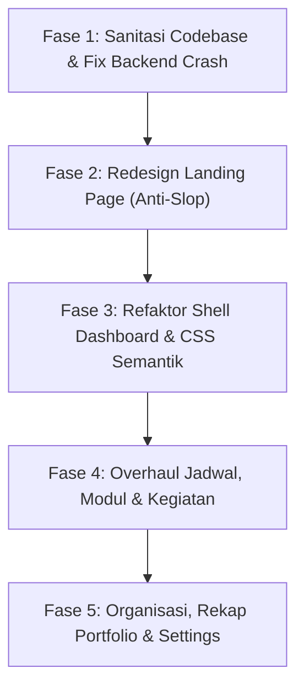

# 🏛️ ROADMAP & MASTER BLUEPRINT REVAMP nGampUS
## Fokus: Role Mahasiswa (User Experience, Sistem Flow, Backend Logic & Anti-AI-Slop Redesign)

> **Dokumen Resmi Pengembangan & Rekayasa Ulang Platform ngampUS**  
> **Terakhir Diperbarui:** 5 November 2026  
> **Status:** Siap Eksekusi Bertahap (Fase 1 s/d Fase 5)  
> **Target:** Menghilangkan seluruh jejak *AI-Slop*, menata arsitektur backend & database agar anti-crash, menyempurnakan flow navigasi, dan menghadirkan workspace produktivitas mahasiswa Indonesia berstandar *world-class*.

---

## 📑 DAFTAR ISI
1. [Prinsip Desain & Identitas Visual Baru (Anti-AI-Slop)](#1-prinsip-desain--identitas-visual-baru-anti-ai-slop)
2. [Matriks Audit Kritis: Backend, Database & Logic Gaps](#2-matriks-audit-kritis-backend-database--logic-gaps)
3. [Audit Per Halaman & Ruang Lingkup Perbaikan (Page-by-Page)](#3-audit-per-halaman--ruang-lingkup-perbaikan-page-by-page)
4. [Rencana Aksi Bertahap (Phases & Granular Substeps)](#4-rencana-aksi-bertahap-phases--granular-substeps)
   - [Fase 1: Sanitasi Codebase, Eliminasi Dead Code & Fix Crash Kritis Backend](#fase-1-sanitasi-codebase-eliminasi-dead-code--fix-crash-kritis-backend)
   - [Fase 2: Redesign Total Landing Page (Human, Editorial & High-Conversion)](#fase-2-redesign-total-landing-page-human-editorial--high-conversion)
   - [Fase 3: Rekayasa Ulang Dashboard Shell, Tema Semantik & Sistem Navigasi](#fase-3-rekayasa-ulang-dashboard-shell-tema-semantik--sistem-navigasi)
   - [Fase 4: Overhaul Fitur Inti Akademik & AI (Jadwal, Modul & Kegiatan)](#fase-4-overhaul-fitur-inti-akademik--ai-jadwal-modul--kegiatan)
   - [Fase 5: Penyempurnaan Organisasi, Semester, Rekap Portofolio & Profil Pengaturan](#fase-5-penyempurnaan-organisasi-semester-rekap-portofolio--profil-pengaturan)
5. [Standar Kualitas & Kriteria Selesai (Definition of Done)](#5-standar-kualitas--kriteria-selesai-definition-of-done)

---

## 1. Prinsip Desain & Identitas Visual Baru (Anti-AI-Slop)

### A. Diagnosa: Kenapa Tampilan Lama Terasa Sangat "AI Slop"?
```
❌ CIRI-CIRI AI SLOP PADA KODE LAMA:
├── Visual Cliché     : Bola gradasi neon (#c8ef70) melayang tak tentu arah (orb-float-1..3).
├── Typography Slop   : Jargon sci-fi palsu ("CAMPUS CODEX // 04", "FIELD NOTE / 03", "ROOT CONSOLE").
├── False Hype        : Badge statistik fiktif ("v2.4 LIVE • BUILT FOR INDONESIAN STUDENTS").
├── Distraksi Gerak   : Ticker teks bergerak tiada henti di landing page yang membuat mata cepat lelah.
├── CSS Spaghetti     : 1.500+ baris override '!important' di globals.css yang memaksakan dark mode 
│                       secara brute-force melalui selector substring regex.
└── Uncanny Cards     : Card tebal dengan border gelap pekat yang tidak memiliki ritme visual manusiawi.
```

### B. Arah Baru: *The Campus Journal & Modern Command Center*
Kita merombak total estetika menjadi **jurnal akademik kontemporer & pusat kendali mahasiswa yang tenang, hangat, dan berwibawa**:

1. **Palet Warna Alami & Bernafas (*Organic Paper & Botanical Pine*)**:
   - **Kanvas Utama (Light)**: Warm Off-White / Gading Akademik (`#faf9f6` / `#f5f4ef`) dengan tekstur halus tanpa noise berlebihan.
   - **Teks Primer**: Hijau Pinus Gelap (*Deep Forest Pine* `#122b1e`), memberikan kontras tinggi yang ramah mata saat membaca lama.
   - **Aksen Fungsional**: Hijau Daun Lumut (*Botanical Sage* `#2e7d5b`) untuk status positif, serta Kuning Tembaga (*Warm Amber* `#d97706`) dan Merah Bata Lembut (*Terracotta* `#dc2626`) untuk deadline yang mendesak.
   - **Mode Gelap Semantik**: Obsidian Hangat (`#0c1611`), bukan hitam pekat mati `#000000`. Card menggunakan `#13241b` dengan border berdimensi halus `rgba(255,255,255,0.08)`.

2. **Tipografi Berwibawa & Manusiawi**:
   - Menggunakan font display berkartakter kuat untuk heading utama, didukung font sans-serif modern yang sangat terbaca (*legible*).
   - Membuang semua kata-kata sci-fi robotik. Menggantinya dengan bahasa mahasiswa Indonesia yang elegan dan lugas:
     - *"CAMPUS CODEX"* $\rightarrow$ **"Arsip Modul & Catatan Kuliah"**
     - *"LIVE ATLAS RADAR"* $\rightarrow$ **"Radar Deadline Tugas"**
     - *"ATELIER LEDGER"* $\rightarrow$ **"Ringkasan Semester Berjalan"**

3. **Card & Komponen Fisikal yang Bernafas**:
   - Border ultra-halus (*1px hairline border*).
   - Bayangan bertingkat lembut (*diffused ambient elevation*), bukan glowing drop-shadow neon yang menyilaukan.
   - Micro-interaction halus: hover terangkat 2px dengan transisi kurva bezier ergonomis (`cubic-bezier(0.16, 1, 0.3, 1)`).

---

## 2. Matriks Audit Kritis: Backend, Database & Logic Gaps

| Area Sistem | Masalah Di Belakang Layar (*Behind-the-Scenes Bug*) | Dampak Pada Mahasiswa | Solusi Rekayasa |
| :--- | :--- | :--- | :--- |
| **Jadwal Kuliah** | `CourseFormModal` tidak mengecek `semesters.length`. Jika user belum punya semester, dropdown kosong dan form melempar exception foreign-key crash dari Supabase. | Mahasiswa baru yang ingin langsung memasukkan jadwal kuliah akan mengalami error fatal. | Tambahkan guard validasi di modal: jika belum ada semester, tampilkan alert interaktif dan tombol 1-klik untuk membuat semester pertama. |
| **Jadwal Kuliah** | Tidak ada detektor bentrok jadwal (*Schedule Conflict Engine*). Sistem membiarkan 2 mata kuliah memiliki hari dan rentang jam yang bertubrukan. | Mahasiswa tidak sadar jadwal kelasnya bentrok sampai hari perkuliahan tiba. | Buat engine validasi client + server: beri peringatan jika jam kuliah baru overlap dengan mata kuliah lain di hari yang sama. |
| **Kegiatan & Agenda** | Server action `togglePortfolio` sudah dibuat di backend (`actions.ts`), tetapi **sama sekali tidak dihubungkan ke tombol UI** di card kegiatan. | Mahasiswa harus repot membuka form edit hanya untuk menandai sebuah tugas/proker masuk portofolio. | Pasang tombol bintang ⭐ 1-klik di card kegiatan dengan transisi optimistik dan feedback toast instan. |
| **Kegiatan & Agenda** | Di `src/app/(dashboard)/kegiatan/page.tsx`, terdapat inisialisasi query `countBase` (baris 49–51) yang tidak pernah dipanggil di `Promise.all` (dead query). | Beban memori kompilasi Server Component kotor. | Bersihkan deklarasi mati dan optimalkan kalkulasi tab filter langsung dari data yang ter-cache. |
| **Modul & Dokumen** | Fungsi `deleteModule` di `actions.ts` menghapus baris tabel di Postgres, namun **tidak menghapus berkas fisik di Supabase Storage bucket `course-materials`**. | Storage bucket membengkak oleh file yatim (*orphaned storage blobs*). | Tambahkan pembersihan berkas otomatis via Supabase Storage API (`supabase.storage.from("course-materials").remove([filePath])`) sebelum menghapus record DB. |
| **AI Study Suite** | File `ai-actions.ts` dan `gemini.ts` banyak menggunakan tipe `any` dan tidak memiliki fallback jika response Gemini menghasilkan markdown codeblock ` ```json `. | Berpotensi crash JSON parse di sisi server dan memicu error ESLint pada production build. | Buat sanitasi JSON parser anti-markdown dan perbaiki typing strict untuk payload Gemini. |
| **Organisasi** | Logo organisasi disimpan dengan cara hacky: teks base64 panjang dikemas ke dalam kolom teks `catatan` menggunakan tag `[[ORG_LOGO:...]]` (bisa sampai 100.000 karakter). | Postgres WAL logs membengkak, ukuran row tabel tidak efisien, dan data catatan rentan korup jika string terpotong. | Normalisasi skema: sediakan upload storage resmi atau simpan URL CDN bersih. |
| **Semester** | Saat semester dihapus, foreign key `ON DELETE CASCADE` di tabel `courses` otomatis menghapus semua mata kuliah dan modul tanpa peringatan detail ke user. | Mahasiswa tidak sengaja kehilangan seluruh catatan modul, kuis AI, dan jadwal kuliah satu semester. | Tambahkan modal konfirmasi berlapis: rincikan jumlah matkul, modul, dan tugas yang akan ikut terhapus. |
| **Portofolio CV** | Di `src/app/(dashboard)/rekap/portfolio/page.tsx`, query dieksekusi dalam **3 blok `Promise.all` bertingkat (waterfall)**: User $\rightarrow$ Profile $\rightarrow$ Activities & Orgs. | Halaman resume terasa lambat dimuat (*high Time-to-First-Byte*). | Satukan seluruh fetch data ke dalam 1 eksekusi `Promise.all` tunggal secara paralel. |
| **Pengaturan Akun** | Foto profil di `profile-form.tsx` mengirimkan string base64 panjang data URL langsung ke update tabel Postgres profiles. | Row tabel profiles menjadi sangat berat dan memperlambat query layout dashboard yang dipanggil di setiap pergantian halaman. | Unggah hasil crop foto ke storage bucket `avatars` terlebih dahulu, lalu simpan URL publiknya saja ke database. |
| **Styling Global** | Terdapat 1.500+ baris CSS di `globals.css` dengan ratusan rule `!important` untuk menimpa class Tailwind secara paksa di dark mode. | Render rendering lambat (*CSS parsing overhead*), layout berkedip saat navigasi, dan debugging styling sangat sulit. | Hapus seluruh class `!important` usang. Gunakan Tailwind v4 inline CSS variables yang semantik dan bersih. |

---

## 3. Audit Per Halaman & Ruang Lingkup Perbaikan (Page-by-Page)

```
STRUKTUR HALAMAN ROLE MAHASISWA:
├── / (Landing Page)
├── /(auth)
│   ├── /login
│   ├── /register
│   ├── /forgot-password
│   └── /reset-password
└── /(dashboard)
    ├── /dashboard (Pusat Kendali Mahasiswa)
    ├── /jadwal (Jadwal Kuliah & Ruang Virtual)
    ├── /kegiatan (Tugas, Reminder & Proker)
    ├── /modul & /modul/[id] (Materi Kuliah & AI Tutor)
    ├── /organisasi & /organisasi/[id] (Struktur & Proker)
    ├── /semester (Konteks Akademik)
    ├── /rekap & /rekap/portfolio (Evaluasi & ATS CV)
    └── /settings (Profil, Foto & Keamanan)
```

### 1. Landing Page (`/`)
- **Tampilan Visual**:
  - Hapus: orbs mengambang, background tech gelap pekat dengan pendaran hijau alien, ticker berjalan tak berkesudahan, dan badge versi palsu `"v2.4 LIVE"`.
  - Hadirkan: Hero section hangat dengan headline bernas yang menyuarakan keresahan mahasiswa (jadwal kuliah tercecer di WhatsApp, proker bertabrakan, deadline menumpuk).
  - Tampilkan Interactive Preview yang nyata: tab interaktif yang bisa diklik langsung oleh pengunjung web untuk merasakan pengalaman mengorganisir jadwal, tugas, dan portofolio.
  - Bento grid bernuansa *editorial campus journal* dengan studi kasus visual realistis (bukan sekadar placeholder).

### 2. Autentikasi (`/login`, `/register`, `/forgot-password`, `/reset-password`)
- **Flow & UX**:
  - Perbaiki container layout auth: hindari `h-screen overflow-hidden` kaku yang memotong tombol daftar di layar smartphone kecil saat keyboard virtual muncul.
  - Sediakan feedback validasi password realtime saat mendaftar (indikator kekuatan kata sandi, minimal 8 karakter).
  - Sempurnakan transisi flip card: form register dan login memiliki reset state yang bersih sehingga pesan error tidak saling tumpang tindih.
  - Terjemahkan seluruh pesan error sistem Supabase ke bahasa Indonesia yang ramah (contoh: *"Alamat email ini sudah terdaftar. Silakan masuk atau gunakan fitur lupa password"*).

### 3. Dashboard Mahasiswa (`/dashboard`)
- **Flow & Data**:
  - Sapaan cerdas berdasarkan waktu WIB (Pagi, Siang, Sore, Malam) dan nama depan mahasiswa secara natural tanpa badge sci-fi.
  - Penanganan akun baru (0 semester & 0 matkul): Tampilkan *Onboarding Checklist* yang elegan, membimbing mahasiswa dari (1) Menentukan Semester $\rightarrow$ (2) Menambah Mata Kuliah Pertama $\rightarrow$ (3) Mencatat Deadline Tugas Pertama.
  - Widget "Perkuliahan Hari Ini": Tampilkan badge status kelas (Sedang Berlangsung / Akan Datang / Selesai), ruang kuliah, dan tombol 1-klik masuk Google Meet / Zoom.
  - Widget "Radar Deadline": Urutkan tugas berdasarkan sisa jam, berikan visual countdown yang jelas untuk H-1 dan H-2.
  - Tombol ceklis tugas cepat (`QuickCompleteButton`): Pertahankan update optimistik yang sudah ada dan pastikan revalidasi sinkron.

### 4. Jadwal Kuliah (`/jadwal`)
- **Flow & Backend**:
  - **Kritikal**: Tangani kondisi saat semester belum ada di `course-form-modal.tsx` dengan memberikan tombol cepat membuat semester.
  - Tambahkan fitur **Deteksi Bentrok Jam Kuliah**: jika user memilih jam kuliah yang tumpang tindih dengan mata kuliah yang sudah ada di hari yang sama, tampilkan notifikasi peringatan.
  - Wallpaper Lockscreen Jadwal (Canvas 9:16): Perbaiki rendering tipografi dan kontras agar hasil unduhan gambar tampak tajam dan estetik saat dijadikan wallpaper layar kunci smartphone.
  - Export Kalender `.ics`: Pastikan format VCALENDAR kompatibel sempurna dengan Google Calendar, Apple Calendar, dan Outlook (termasuk deskripsi dosen dan link pertemuan).

### 5. Kegiatan & Agenda (`/kegiatan`)
- **Flow & Backend**:
  - Pasang tombol aksi cepat 1-klik pada setiap card tugas:
    - Tombol transisi status: *Belum Mulai* $\rightarrow$ *On Progress* $\rightarrow$ *Selesai*.
    - Tombol bintang portofolio (⭐): menghubungkan server action `togglePortfolio` yang sebelumnya menganggur.
  - Bersihkan dead query `countBase` pada file page.
  - Perbaiki filter pencarian teks agar mendukung pencarian berdasarkan nama mata kuliah atau nama organisasi, bukan hanya judul tugas saja.

### 6. Modul Perkuliahan & AI Companion (`/modul` & `/modul/[id]`)
- **Flow & Backend**:
  - Buang seluruh label sci-fi `"CAMPUS CODEX // 04"` dan gantikan dengan antarmuka arsip materi akademik yang rapi per pertemuan (P1 hingga P16).
  - Hubungkan upload file ke Supabase Storage dengan penamaan unik dan sanitasi nama file.
  - **Pembersihan Storage**: Pastikan ketika modul dihapus, file dokumen terkait di Supabase Storage ikut terhapus.
  - AI Engine: Perbaiki parser respons Gemini agar tahan terhadap format Markdown (` ```json `), dan berikan streaming / loading state yang elegan saat membuat ringkasan dan kuis UTS/UAS.

### 7. Organisasi & Proker (`/organisasi` & `/organisasi/[id]`)
- **Flow & Backend**:
  - Hentikan pemaksaan base64 logo ke dalam teks catatan `[[ORG_LOGO:...]]`.
  - Berikan input URL logo resmi atau upload logo berukuran ringan yang disimpan terpisah.
  - Sediakan kalkulator progress proker: persentase kegiatan yang selesai dari seluruh rangkaian proker organisasi.

### 8. Semester (`/semester`)
- **Flow & Backend**:
  - Tampilkan indikator minggu akademik berjalan (contoh: *"Minggu ke-7 dari 16 Minggu Perkuliahan"* dihitung dari rentang tanggal mulai dan selesai).
  - Berikan modal konfirmasi bahaya saat menghapus semester, menjelaskan bahwa matkul dan modul di dalamnya akan ikut terhapus.

### 9. Rekap & Portofolio CV (`/rekap` & `/rekap/portfolio`)
- **Flow & Backend**:
  - Satukan query bertingkat menjadi satu `Promise.all` paralel.
  - Tampilkan panduan praktis jika portofolio masih kosong: *"Tandai kegiatan atau proyek kuliahmu dengan bintang ⭐ untuk otomatis merangkumnya di sini"*.
  - Sempurnakan template CV ATS: tipografi bersih, layout formal standar industri, tombol cetak PDF instan tanpa sidebar atau tombol navigasi yang ikut ter-print.

### 10. Pengaturan Profil (`/settings`)
- **Flow & Backend**:
  - Perbaiki peringatan React `setIdleTimeout` di dalam effect.
  - Ganti penyimpanan foto profil base64 langsung di database menjadi upload ke Supabase Storage bucket `avatars`.
  - Sederhanakan komponen `profile-form.tsx` yang membengkak (1.193 baris) menjadi sub-komponen terstruktur yang mudah dipelihara.

---

## 4. Rencana Aksi Bertahap (Phases & Granular Substeps)



---

### Fase 1: Sanitasi Codebase, Eliminasi Dead Code & Fix Crash Kritis Backend (SELESAI ✓)
> **Tujuan**: Membersihkan semua sampah teknis, menyelesaikan 243 warning/error linter, dan menutup celah error database pada alur pengguna baru.

- [x] **Substep 1.1**: Hapus file yatim yang tidak diimpor:
  - Hapus `src/components/auth/auth-form.tsx` (219 baris kode lama).
  - Hapus file default Next.js yang tidak dipakai di `public/` (`file.svg`, `globe.svg`, `next.svg`, `vercel.svg`, `window.svg`).
  - Hapus helper yang tidak pernah diimpor: `src/lib/utils.ts` (atau jika tetap dipakai, jadikan utilitas bersama).
- [x] **Substep 1.2**: Bersihkan dead code di file logic:
  - Hapus rate limiter mati `adminLimiter` di `src/lib/rate-limiter.ts`.
  - Hapus konstanta mati `RATE_LIMITED_AUTH` di `src/middleware.ts` dan `PER_MINUTE_TOKEN_LIMIT` di `src/lib/ai-telemetry.ts`.
  - Hapus query mati `countBase` di `src/app/(dashboard)/kegiatan/page.tsx`.
- [x] **Substep 1.3**: Pangkas dead CSS di `src/app/globals.css`:
  - Hapus 6 keyframes mati: `toast-shimmer`, `badge-pulse`, `bar-grow`, `orbit-slow`, `shimmer-drift`, `subtle-pulse`.
  - Hapus 27 class usang: `.auth-form-card`, `.hero-orb`, `.noise-overlay`, `.grid-paper`, `.landing-canvas`, `.sticker`, `.feature-card`, `.atlas-sun`, dll.
  - Hapus blok usang `main.grid.min-h-screen`.
- [x] **Substep 1.4**: Bersihkan 155+ unused imports (terutama icon `lucide-react`) di seluruh komponen.
- [x] **Substep 1.5**: **FIX CRITICAL BACKEND BUG DI JADWAL**:
  - Edit `src/components/schedule/course-form-modal.tsx`: Berikan pengecekan jika `semesters.length === 0`.
  - Cegah pengiriman form kosong dan tampilkan banner bantuan langsung ke `/semester`.
- [x] **Substep 1.6**: **OPTIMASI QUERY PORTFOLIO**:
  - Satukan 3 pemanggilan `Promise.all` di `src/app/(dashboard)/rekap/portfolio/page.tsx` menjadi 1 eksekusi paralel tunggal.
- [x] **Substep 1.7**: Verifikasi build: Jalankan `npx tsc --noEmit` dan `npm run lint` hingga mencapai 0 error.

---

### Fase 2: Redesign Total Landing Page (Human, Editorial & High-Conversion) (SEDANG BERJALAN)
> **Tujuan**: Menghapus seluruh kesan "AI template murahan" dan menyajikan landing page kelas dunia yang elegan, hangat, dan relevan bagi mahasiswa Indonesia. Dikerjakan bertahap per substep secara presisi.

- [x] **Substep 2.1**: Redesign Hero Section di `src/app/page.tsx` (SELESAI ✓):
  - Hapus bola neon hijau berpendar, grain berlebihan, dan badge fiktif `"v2.4 LIVE"`.
  - Gunakan palet hangat (*warm off-white* `#faf9f6` dan teks *deep forest pine* `#122b1e`).
  - Tulis headline editorial tajam:
    > *"Kuliah teratur. Ambisi organisasi tetap melesat."*
  - Subtitle yang jujur dan menyentuh realitas mahasiswa Indonesia (jadwal kelas tidak lagi hilang di grup WA, deadline tugas terpantau rapi).
  - Micro-detail: CTA button ergonomic, trust badges yang elegan, typography scale responsive dengan `text-balance` & `text-pretty`.
- [ ] **Substep 2.2**: Redesign Sticky Navbar (`src/components/landing/landing-navbar.tsx`):
  - Tampilan floating pill dengan efek kaca halus (*frosted glass*), logo ngampUS tajam, link navigasi natural, dan CTA *"Masuk"* & *"Daftar Gratis"*.
- [ ] **Substep 2.3**: Upgrade `src/components/landing/interactive-preview.tsx`:
  - Hapus mockup browser bernuansa sci-fi gelap dan traffic lights macOS.
  - Buat visualisasi workspace nyata: kartu jadwal hari ini yang interaktif, radar tugas dengan deadline jelas, dan pratinjau resume CV ATS.
- [ ] **Substep 2.4**: Redesign Bento Grid Fitur:
  - Bento Card 1: *Jadwal Cerdas & Sinkronisasi Kalender (.ICS)*.
  - Bento Card 2: *Radar Deadline & Pengingat Tugas*.
  - Bento Card 3: *Arsip Modul & AI Study Companion (Tanya Materi & Kuis)*.
  - Bento Card 4: *Manajemen Struktur Organisasi & Proker*.
  - Bento Card 5: *Portofolio Otomatis Siap Ekspor Jadi Resume Magang*.
- [ ] **Substep 2.5**: Redesign Workflow & FAQ:
  - Alur 4 langkah mahasiswa menyongsong semester baru dengan tenang.
  - FAQ accordion yang bersih dan transparan (gratis, keamanan data mahasiswa, isolasi RLS).
- [ ] **Substep 2.6**: Sempurnakan Footer: Brand bersih, navigasi rapi, dan credit humanis.

---

### Fase 3: Rekayasa Ulang Dashboard Shell, Tema Semantik & Sistem Navigasi
> **Tujuan**: Menghilangkan 1.500 baris hack CSS `!important`, menstandarkan desain token, dan menciptakan shell dashboard yang nyaman digunakan berjam-jam saat belajar.

- [ ] **Substep 3.1**: Restrukturisasi CSS di `src/app/globals.css`:
  - Buat token CSS semantik: `--bg-base`, `--bg-surface`, `--bg-surface-raised`, `--text-primary`, `--text-secondary`, `--text-muted`, `--border-subtle`, `--accent-primary`.
  - Hilangkan brute-force substring selector (`[class*="..."]`).
- [ ] **Substep 3.2**: Perbaiki `src/components/theme-provider.tsx`:
  - Hapus panggilan `setState` yang memicu cascading render warning di React 19.
  - Pastikan pergantian tema Light / Dark berjalan instan tanpa layout shift.
- [ ] **Substep 3.3**: Redesign Sidebar & Mobile Navigation (`src/components/dashboard/sidebar.tsx`):
  - Tampilan sidebar bersih dengan identitas kampus pengguna, status semester aktif, dan navigasi ergonomis.
  - Mobile bottom navigation bar yang nyaman dijangkau ibu jari (*thumb zone*).
- [ ] **Substep 3.4**: Redesign Header Utama Dashboard (`src/app/(dashboard)/dashboard/page.tsx`):
  - Buang label robotik `"CAMPUS ATELIER // WORKSPACE"`.
  - Berikan sapaan hangat, tanggal hari ini dalam format Bahasa Indonesia yang elegan, dan kartu profil yang ringkas.
- [ ] **Substep 3.5**: Sempurnakan Penanganan Akun Baru (Zero-State Onboarding):
  - Jika belum ada data semester atau matkul, hadirkan panduan onboarding interaktif yang ramah tanpa merusak tata letak dashboard.

---

### Fase 4: Overhaul Fitur Inti Akademik & AI (Jadwal, Modul & Kegiatan)
> **Tujuan**: Menjamin seluruh fitur utama perkuliahan bekerja presisi, cepat, dan bebas dari kebingungan pengguna.

- [ ] **Substep 4.1**: Upgrade Halaman Jadwal Kuliah (`/jadwal`):
  - Sempurnakan tampilan kartu mata kuliah dengan badge waktu, SKS, nama dosen, ruangan, dan tombol akses cepat link kuliah online.
  - Implementasikan deteksi bentrok jadwal: beri peringatan jika jam kuliah tumpang tindih.
  - Perbaiki generator wallpaper HP (Canvas 9:16) agar hasil render tajam dan proporsional di smartphone modern.
- [ ] **Substep 4.2**: Upgrade Halaman Modul Kuliah (`/modul` & `/modul/[id]`):
  - Rombak tampilan daftar modul: urutan P1 hingga P16 yang intuitif, status baca (*Belum Dibaca*, *Sudah Dibaca*, *Dipelajari*).
  - Hubungkan pembersihan dokumen di Supabase Storage saat modul dihapus (`deleteModule`).
  - Rapikan antarmuka AI Study Companion: Modal kuis interaktif, modal rangkuman konsep penting, dan chat tutor dengan typing indicator yang halus.
  - Hilangkan seluruh tipe `any` pada `ai-actions.ts` dan `src/lib/gemini.ts`.
- [ ] **Substep 4.3**: Upgrade Halaman Kegiatan & Agenda (`/kegiatan`):
  - Tambahkan tombol bintang (⭐) 1-klik di kartu kegiatan untuk menghubungkan server action `togglePortfolio`.
  - Tambahkan tombol pergantian status cepat (Belum Mulai $\rightarrow$ On Progress $\rightarrow$ Selesai) langsung dari list item tanpa harus membuka form edit.
  - Sempurnakan filter pencarian agar responsif dan akurat.

---

### Fase 5: Penyempurnaan Organisasi, Semester, Rekap Portofolio & Profil Pengaturan
> **Tujuan**: Mengintegrasikan seluruh jejak organisasi, evaluasi beban belajar, dan ekspor CV siap pakai yang profesional.

- [ ] **Substep 5.1**: Upgrade Manajemen Organisasi (`/organisasi` & `/organisasi/[id]`):
  - Hentikan hack penyimpanan logo di dalam teks `catatan`. Sediakan field logo resmi.
  - Perjelas visual struktur jabatan (Ketua, BPH, Kadiv, Anggota) dan monitoring program kerja.
- [ ] **Substep 5.2**: Upgrade Manajemen Semester (`/semester`):
  - Tambahkan penghitung minggu perkuliahan berjalan ("Minggu ke-X dari 16 Minggu").
  - Berikan modal konfirmasi hapus semester dengan peringatan bahwa mata kuliah dan modul di dalamnya akan ikut terhapus.
- [ ] **Substep 5.3**: Upgrade Rekapitulasi & Portofolio CV (`/rekap` & `/rekap/portfolio`):
  - Tampilkan visual analytics beban belajar yang bersih dan mudah dipahami.
  - Perbaiki template CV ATS: pastikan font formal, layout rapi, dan print stylesheet sempurna (hanya mencetak dokumen resume tanpa navigasi web).
  - Tampilkan callout jika portofolio masih kosong: panduan cara memberi tanda bintang ⭐ pada tugas kuliah/proker.
- [ ] **Substep 5.4**: Refaktor Halaman Pengaturan (`/settings` & `profile-form.tsx`):
  - Pecah file raksasa (1.193 baris) menjadi sub-komponen modular (Foto & Avatar, Data Akademik, Kontak Sosial, Keamanan & Password, Pengaturan Sesi).
  - Ganti penyimpanan foto profil base64 menjadi upload file ke Supabase Storage bucket `avatars`.
  - Selesaikan warning React Effect pada `idleTimeout`.
- [ ] **Substep 5.5**: Verifikasi Menyeluruh & Testing Linting/Build:
  - Jalankan test build produksi `npm run build` dan pastikan 0 error, 0 warning kritis, dan performa halaman cepat.

---

## 5. Standar Kualitas & Kriteria Selesai (Definition of Done)

Sebuah fase atau fitur dinyatakan **SELESAI (DONE)** jika memenuhi kriteria mutlak berikut:

1. **Zero Dead Code**: Tidak ada file yatim piatu, tidak ada import icon `lucide-react` yang tidak dipakai, dan tidak ada server action yang menganggur.
2. **Zero TypeScript & ESLint Errors**: Perintah `npx tsc --noEmit` dan `npm run lint` selesai dengan kode exit 0 tanpa error fatal.
3. **Strict Data & Foreign Key Integrity**: Tidak ada form yang memicu unhandled database constraint exception ketika data dependensi (seperti semester) belum ada.
4. **No Storage Leak**: Penghapusan entitas modul atau foto wajib membersihkan file fisiknya di Supabase Storage.
5. **Anti-AI-Slop Verified**: Bebas dari bola neon berhamburan, ticker berjalan yang mengganggu mata, label sci-fi palsu (*"CODEX"*, *"LIVE ATLAS"*), dan 1.500 baris hack `!important` di stylesheet.
6. **Mobile First & PWA Ready**: Seluruh form dan navigasi nyaman digunakan di layar smartphone tanpa elemen yang terpotong saat keyboard virtual aktif.

---

*Dokumen ini menjadi acuan tunggal pengerjaan proyek ngampUS untuk memastikan setiap langkah perubahan terukur, rapi, dan berkualitas tinggi.*

